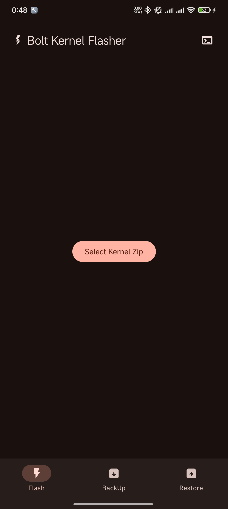
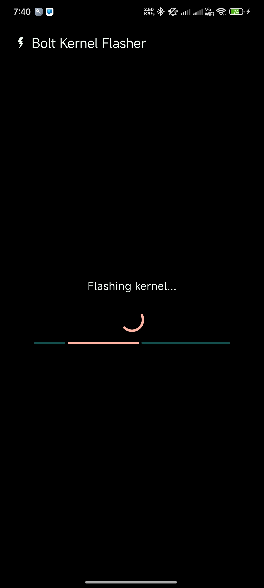
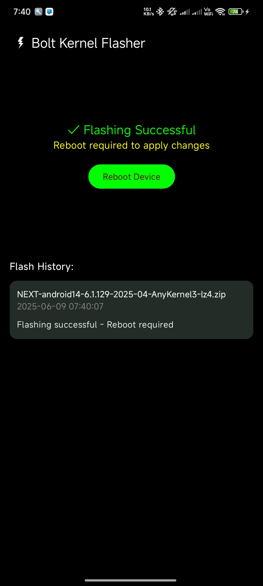
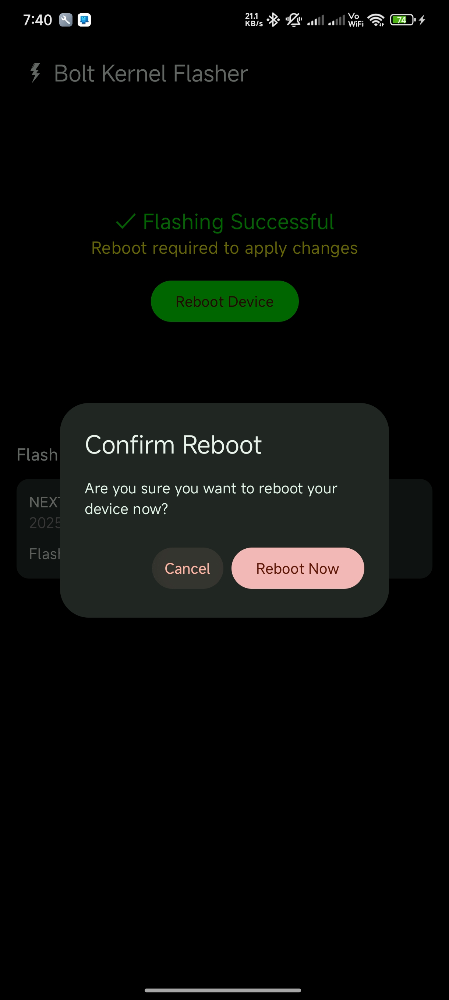
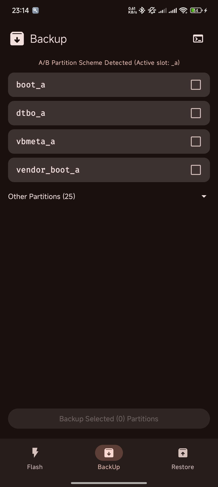
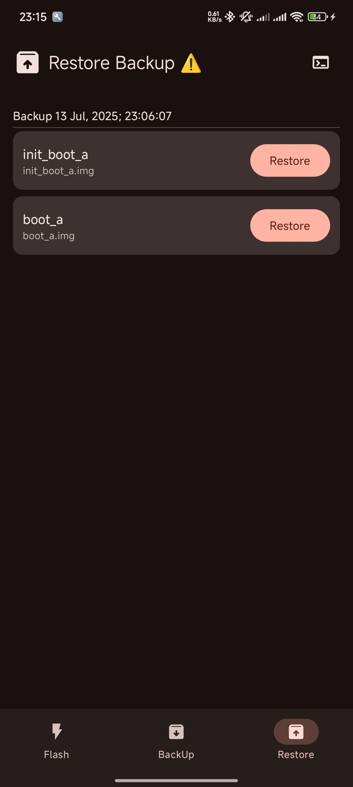
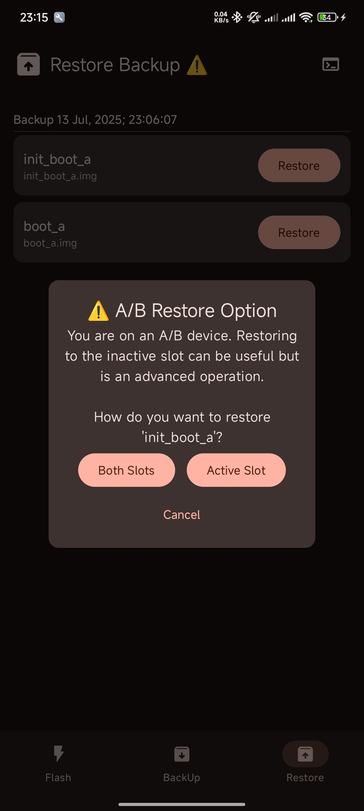

  

<h1 align="center">Bolt Kernel Flasher</h1>

---

## What's This?

Bolt Kernel Flasher is a modern Android application designed to easily flash AnyKernel zips on supported devices. Built entirely with Kotlin, it leverages Material 3 Design and Jetpack Compose for a seamless and intuitive user experience.

### Features

- Copylefted application source (GPLv3.0); bundled runtime provenance documented below
- 100% Kotlin
- Material 3 Design
- Jetpack Compose UI
- Reviewed kernel operations with automatic recovery snapshots and retained logs
- Supports script-based AnyKernel ZIPs with the original installer
- Pinned BusyBox runtime for ARM64, ARM32, x86 and x86-64 (current universal release APK: approximately 5 MiB)
- Verified manifest-based backups and restores for discovered supported partitions
- Application-wide operation ownership, explicit partial outcomes and interrupted-job recovery

### Flashing, backup and recovery

Root is required for privileged work. Imported/shared ZIPs require a separate review;
Bolt does not execute them automatically. Pre-flash snapshots cover discovered active
and shared kernel recovery targets, and cannot guarantee rollback of every change an
installer may make. Legacy backups without a complete manifest cannot be restored.

See [operation and recovery behavior](docs/kernel-flashing.md),
[runtime provenance and release requirements](docs/runtime.md), and
[tests and pending device validation](docs/testing.md).

### Screenshots

### [▶️ Watch Demo](https://youtube.com/shorts/21q9h6YFR3Y?feature=share)
<table>
  <tr>
    <td></td>
    <td></td>
    <td></td>
    <td></td>
    <td></td>
    <td></td>
    <td></td>
  </tr>
</table>

### Warnings

- **Use at your own risk.** Flashing kernels can potentially brick your device.
- **Highly recommended:** Always back up your data and current boot image before proceeding.
- **Check compatibility:** Ensure the kernel format and boot image compression match your device requirements. Mismatches may cause your device to be stuck in a bootloop.
- **Device warranty:** Flashing custom kernels may void your device warranty.
- **Data loss:** Incorrect usage can result in data loss or device malfunction.
- **No liability:** The developers are not responsible for any damage caused by using this tool.

---

## License

This project is licensed under the GNU General Public License v3.0 (GPL-3.0). See the `LICENSE` file for more details.
