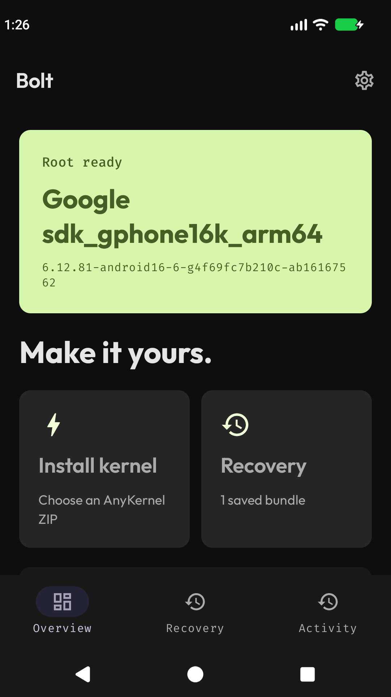
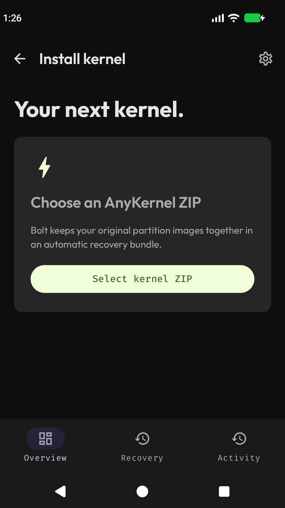
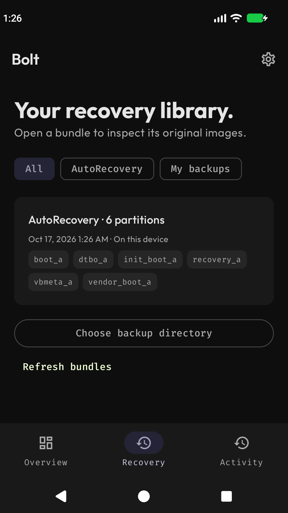
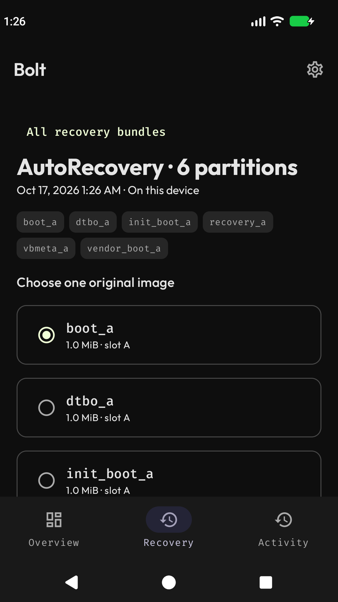
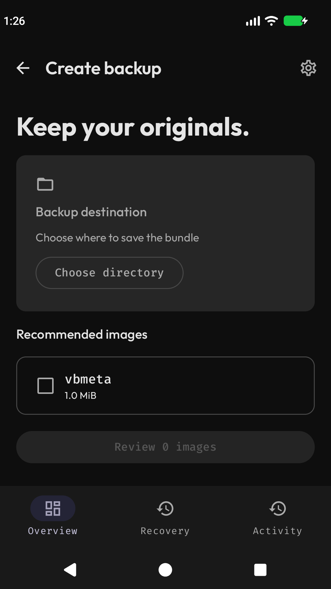
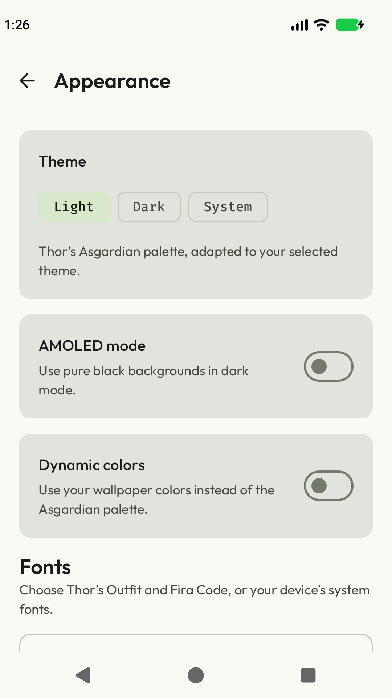
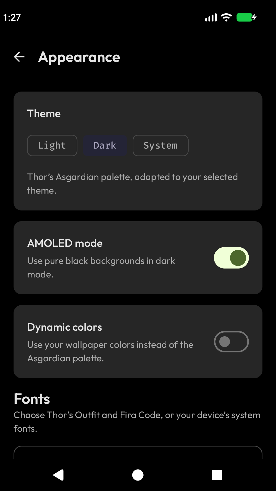
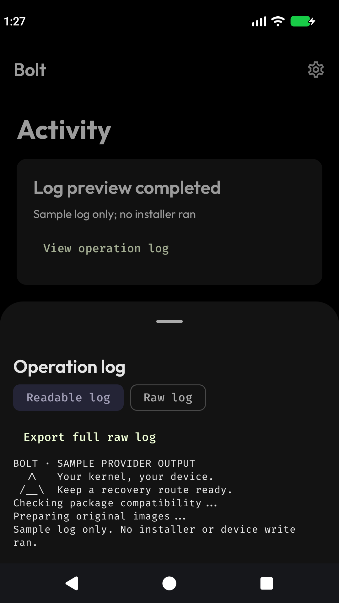

  

<h1 align="center">Bolt Kernel Flasher</h1>

---

## What's This?

Bolt Kernel Flasher is an Android application for flashing compatible AnyKernel ZIPs on rooted devices. It uses Kotlin, Jetpack Compose and Material 3.

### Features

- Copylefted application source (GPLv3.0); bundled runtime provenance documented below
- Kotlin and Jetpack Compose
- Material 3 Design
- Jetpack Compose UI
- Reviewed kernel operations with automatic recovery snapshots and retained logs
- Supports script-based AnyKernel ZIPs with the original installer
- Pinned BusyBox runtime for ARM64, ARM32, x86 and x86-64 (current source release build: approximately 5 MiB)
- Verified manifest-based backups and restores for discovered supported partitions
- Application-wide operation ownership, explicit partial outcomes and interrupted-job recovery
- Cockpit overview, compact recovery bundles and a separate restart/health feedback record
- Thor's Asgardian light/dark palette, Outfit/Fira Code typography and persistent appearance settings

### Flashing, backup and recovery

Root is required for privileged work. Imported/shared ZIPs require a separate review;
Bolt does not execute them automatically. Pre-flash snapshots cover discovered active
and shared kernel recovery targets, and cannot guarantee rollback of every change an
installer may make. Legacy backups without a complete manifest cannot be restored.

See [operation and recovery behavior](docs/kernel-flashing.md),
[runtime provenance and release requirements](docs/runtime.md), and
[tests and pending device validation](docs/testing.md).

Appearance settings offer System, Light and Dark modes, AMOLED backgrounds, Android
12+ dynamic colors, and Asgard or system fonts. See [appearance and font provenance](docs/appearance.md).

### Download and website

[Download the latest published APK](https://github.com/trinadhthatakula/Bolt/releases/latest).
Bolt is distributed through GitHub; there is no Play Store listing.
The landing page is prepared for **https://bolt.trinadhthatakula.com**;
see [web setup and owner-managed hosting](web/README.md).

**Release preview:** the screenshots and Cockpit features below describe current
source. The published `Bolt_v1.01.0` APK (July 2025) predates this interface.
Check release notes for the features included in a downloaded APK.

### Screenshots

Actual app screens captured on a rooted emulator. Recovery bundles and provider
logs use sample data; no kernel was flashed for these captures.
See [screenshot provenance](docs/marketing/README.md).

<table>
  <tr>
    <td></td>
    <td></td>
    <td></td>
    <td></td>
  </tr>
  <tr>
    <td></td>
    <td></td>
    <td></td>
    <td></td>
  </tr>
</table>

[Listing resources and local validation](fastlane/README.md) include the descriptions,
icon, feature graphic and screenshots for the upcoming release.

### Warnings

- **Use at your own risk.** Flashing kernels can potentially brick your device.
- **Highly recommended:** Always back up your data and current boot image before proceeding.
- **Check compatibility:** Ensure the kernel format and boot image compression match your device requirements. Mismatches may cause your device to be stuck in a bootloop.
- **Device warranty:** Flashing custom kernels may void your device warranty.
- **Data loss:** Incorrect usage can result in data loss or device malfunction.
- **No liability:** The developers are not responsible for any damage caused by using this tool.

---

## License

This project is licensed under the GNU General Public License v3.0 (GPL-3.0). See the `LICENSE` file for more details.
